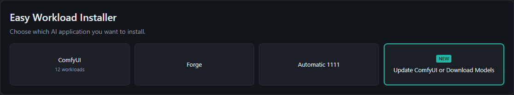
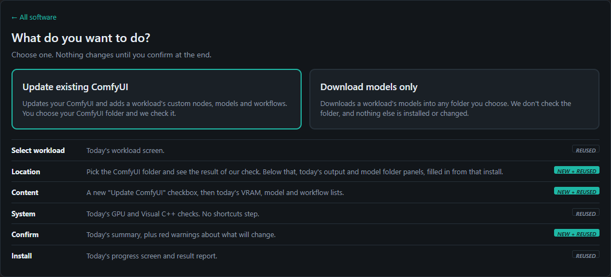
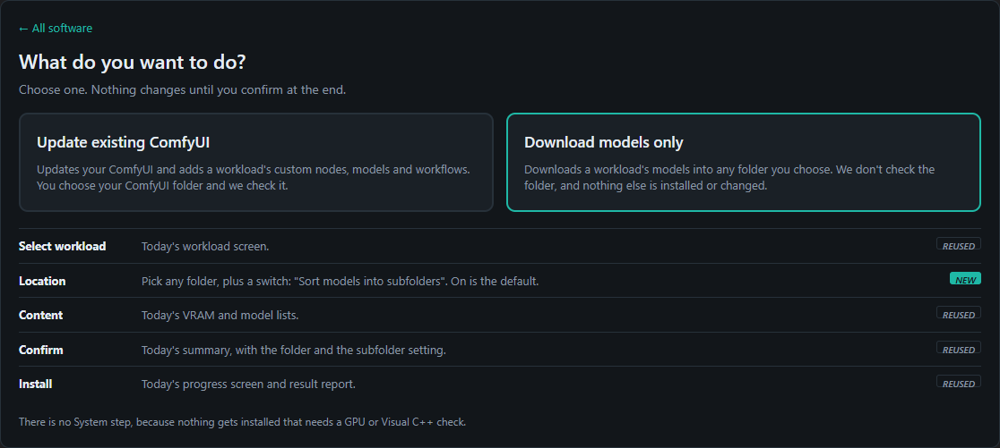
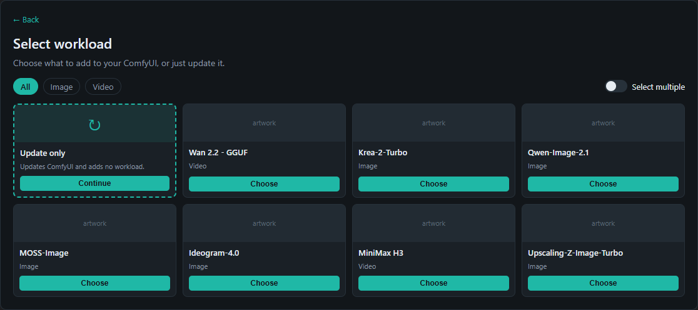
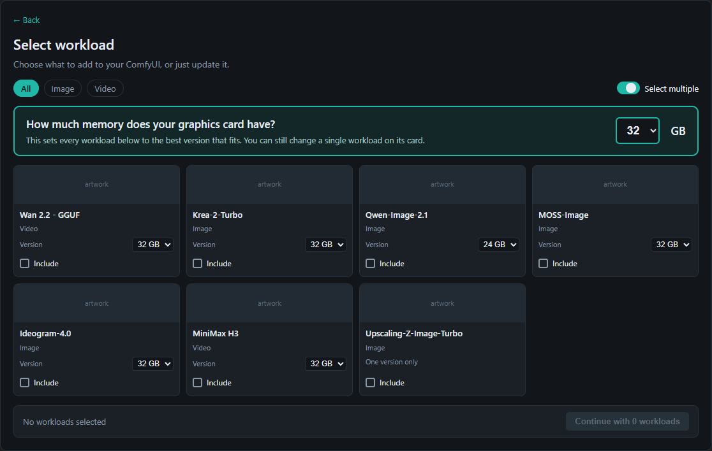
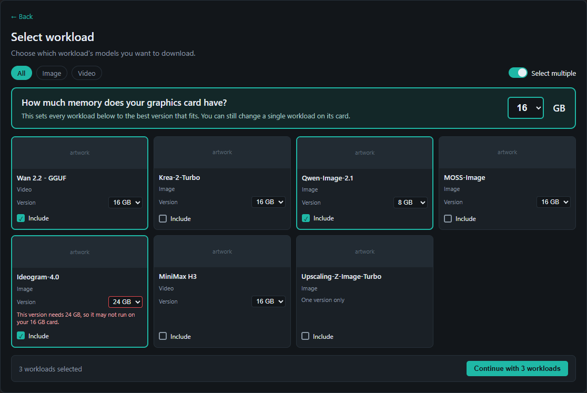
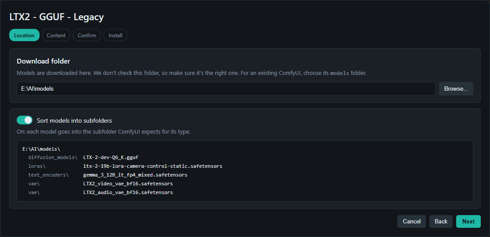
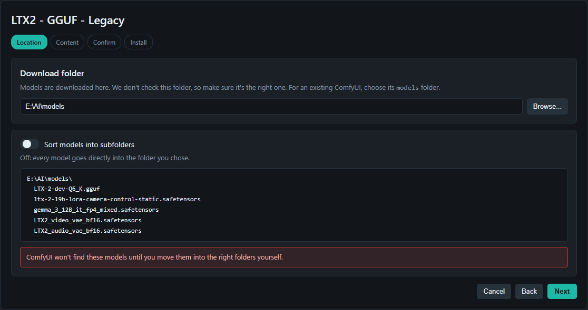
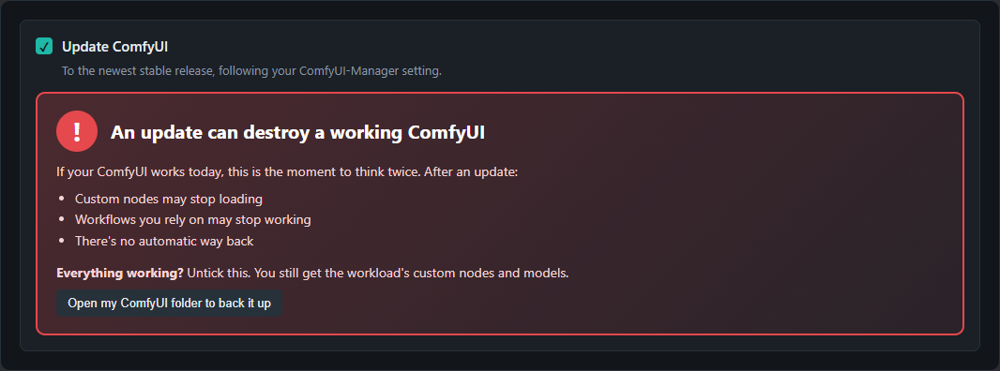
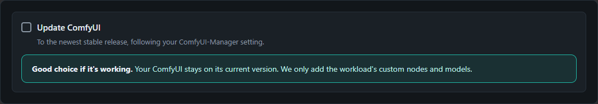

# Update ComfyUI or Download Models: design

**Date:** 2026-11-03
**Status:** Design agreed with the owner in chat. No product code exists yet.
**Issues:** Into-The-Latent/DiffusionNexus.Installer#28 (UI), Little-God1983/DiffusionNexus.Installer.SDK#70 (SDK)
**Branch:** `feature/existing-comfyui` in the Installer repo. It holds only this document and its assets so far.

This design replaces the flow in those two issues where the two disagree. Section 8 lists exactly what changes.

Open the mockups in `assets/2026-11-03-update-or-download-models/mockups/` in a browser. They are clickable, standalone HTML files and are throwaway: they show layout and wording, not code to keep.

## 1. Why

The owner wants existing ComfyUI users to be able to update their install, or to just download a workload's models, without confusing newcomers with two more tiles on the Welcome screen. The answer is one new tile, followed by one screen where the user says which of the two they want.

The two jobs have opposite risk. Updating can break a working ComfyUI, so it checks the folder and warns loudly. Downloading models changes nothing but the chosen folder, so the user is in full charge and nothing is checked.

## 2. Goals, non-goals, anti-goals

**Goals**

- At most one new tile on the Welcome screen.
- A user can update an existing ComfyUI and add a workload's custom nodes, models and workflows.
- A user can download a workload's models into any folder, sorted into subfolders or flat.
- Both paths feel like today's ComfyUI install and reuse its screens.

**Non-goals**

- VRAM detection. The owner has ruled this out. The user always sets the memory size.
- An undo or restore script. The owner considered it and said no.
- Portable, ComfyUI Desktop and conda support on the update path. These still get "not supported yet, do a fresh install".
- Models only for other software (Forge, A1111). The audience is ComfyUI users.
- Any change to the fresh install flow.

**Anti-goals: this has failed even if it technically works when**

- A user is confused about why a workload card looks unavailable. This is why cards never grey out for memory reasons.
- A user only learns from a report line that their workload was left incomplete.
- Models only touches anything outside the chosen folder.

## 3. The flow

### Welcome screen

One new tile, labelled **Update ComfyUI or Download Models**.

### Choice screen

Heading "What do you want to do?", with two large cards. Each card opens the steps listed under it.

| Update existing ComfyUI | Download models only |
|---|---|
|  |  |

Steps on each path:

| Step | Update existing ComfyUI | Download models only |
|---|---|---|
| Select workload | Today's screen, plus Update only tile and Select multiple | Today's screen, plus Select multiple |
| Location | ComfyUI folder + check result + today's output and model folder panels, filled in from that install | Any folder + subfolder switch |
| Content | Update checkbox + today's VRAM, model and workflow lists | Today's VRAM and model lists |
| System | Today's GPU and Visual C++ checks, no shortcuts | Skipped, nothing is installed |
| Confirm | Today's summary + red warnings | Today's summary + folder + subfolder setting |
| Install | Today's screen and report | Today's screen and report |

### Workload screen (both paths)

Today's "Select workload" screen, with these additions:

- **Update only tile (update path only).** First tile. Updates ComfyUI and adds no workload. Hidden while Select multiple is on, because the Update checkbox covers it then.
- **Select multiple switch (both paths).** Replaces each card's button with an Include checkbox and adds a "Continue with N workloads" bar.
- **Models only hides workloads with no models**, such as "Blank ComfyUI + Manager + Triton & SageAttention".

### Memory selection with Select multiple on

The owner rejected a small dropdown and greyed-out cards, because people would not understand why Ideogram was greyed out or realise the setting applies once to everything.

- A large highlighted panel above the cards asks "How much memory does your graphics card have?" and **starts at 32 GB**. No detection.
- Every card has its own Version dropdown listing only the versions that workload ships.
- **Changing the large selector resets every card, including ones changed by hand.** Each card moves to its largest version that fits.
- Changing a card affects only that card.
- If no version of a workload fits, the card stays selectable on its smallest version and shows a red note: "This version needs 24 GB, so it may not run on your 16 GB card." The same note appears when a user picks a too-large version by hand.
- A workload that declares no versions shows "One version only".
- **Cards never grey out for memory reasons.**

| Starts at 32 GB | Selector set to 16 GB |
|---|---|
|  |  |

The Content step leaves out its "Graphics card memory" panel in multi-select. Confirm lists each workload's chosen version, as a last chance to catch a wrong size, because starting at 32 GB gives anyone who ignores the selector the largest downloads.

With a single workload on these two new paths, today's memory panel appears on the Content step but **starts at the workload's highest version** (see section 9, item 1). Fresh installs keep starting at the lowest.

### Models only: Location step

- **Download folder** box with Browse. No check of any kind, not even for ComfyUI. Hint: "We don't check this folder, so make sure it's the right one. For an existing ComfyUI, choose its `models` folder."
- **"Sort models into subfolders" switch, on by default.**
  - On: subfolders go directly inside the chosen folder, such as `E:\AI\models\vae`.
  - Off: every file goes directly into the chosen folder, and a red box says "ComfyUI won't find these models until you move them into the right folders yourself."

| Subfolders on | Subfolders off |
|---|---|
|  |  |

If someone picks `E:\ComfyUI` rather than `E:\ComfyUI\models`, models land in `E:\ComfyUI\vae` and so on. That is accepted: the user is in full charge, and the hint is the only protection.

Models only downloads **only models**: no custom nodes, no workflows, no launcher script, no shortcuts, no `extra_model_paths.yaml`.

### Update path: the Update checkbox and its warning

The checkbox **starts on**, with the big red warning below. The owner asked for this to be done nicely.

| Checkbox on | Checkbox off |
|---|---|
|  |  |

- Headline: **An update can destroy a working ComfyUI**, using the owner's word.
- It says what actually breaks: custom nodes may stop loading, workflows may stop working, no automatic way back.
- It offers the way out: unticking still gets the workload's custom nodes and models.
- A button opens the ComfyUI folder so the user can back it up.
- Unticking replaces the red box with a calm message saying ComfyUI stays on its current version.
- With the Update only tile, the checkbox is on and locked, as #28 planned.

## 4. Kept from #28 and #70

These owner decisions from 2026-09-24 still apply to the **update path**:

1. Custom nodes install with their workloads.
2. Torch upgrades to the biggest selected workload (highest torch and CUDA, Triton and SageAttention if any workload wants them), never downgrades. A workload that differs gets a red warning.
3. Only our own old update script (no `dn-script-version: 2` marker) is replaced.
4. Portable, ComfyUI Desktop and no-venv installs get "not supported yet, do a fresh install". Any venv folder name works.
5. Warnings are red boxes and the user stays in charge. The only hard stop is when the venv's Python has no wheel for the target torch.
6. ComfyUI-Manager is installed if it's missing.
7. The last chosen folder is remembered.

The SDK contract in #70 for the inspector, target resolver, merger, extend flow and unattended update step stays the base. Section 5 adds to it.

## 5. What the SDK needs beyond #70

Facts below were read from the code on 2026-11-03. Nothing here has been built or tested.

### A models-only flow that accepts any folder

The existing `ModelOnlyInstallationFlow` can't be used as it is:

- It also clones custom nodes and exports workflows.
- `ValidateInstallationStepHandler` fails a ComfyUI workload if the folder holds no ComfyUI.
- `PostInstallStepHandler` always writes a launcher script and creates shortcuts.

So this needs a new path that runs only the download step. The installer has never used the old flow: `InstallationOptionsDraft` always sets `OnlyModelDownload = false`. Other SDK consumers may, so the old flow should not change behaviour.

### Subfolders on or off

`ModelDestinationResolver` already gives the subfolder behaviour when `modelBaseFolder` is set: it strips the leading `models/`, so `models/vae` with base `E:\AI\models` becomes `E:\AI\models\vae`. A model with no destination falls back to the workload's default folder, then to `checkpoints`.

Flat mode is new. It should live in the resolver or next to it, so that the download step, the disk space estimate and the model scan all agree on where a file goes. Today's `link.Destination` branch in `ModelDownloadStepHandler` bypasses the resolver; no catalog link sets it today (0 of 191), but flat mode must still honour the chosen folder there.

### Different VRAM per workload in one run

`InstallationOptions.SelectedVramProfile` is one number per run. Planned approach, not yet proven: the merger picks each workload's links up front using that workload's chosen version, and the run then uses `SelectedVramProfile = 0`. Both `VramProfileHelper.SelectBestMatchingLinks` and `DiskSpaceCalculator` already treat 0 as no filtering. The model-level check in `ModelDownloadStepHandler` is also skipped at 0, so the merger must apply it itself.

Relevant existing rules: `SelectBestMatchingLinks` picks the largest version that fits. If none fits, it drops every link that has a VRAM tag and keeps the untagged ones. That is how `Ideogram-4.0` at 16 GB would download only its VAE and text encoder, which is exactly what the new UI must prevent: a user who keeps Ideogram at 16 GB gets its full 24 GB version.

`ModelSelectionModule` scans and lists models using one `SelectedVramProfile`, and `InstallationSummaryBuilder` prints one VRAM value. Both need a look for multi-select.

### Flat mode and file name clashes

No single workload has two different URLs with the same file name (191 links checked). Across workloads, `flux2-vae.safetensors`, `qwen_image_vae.safetensors`, `qwen_3_4b.safetensors` and `4x-UltraSharp.pth` each have two different URLs. It is not known whether those are identical files.

So Select multiple in flat mode can send two files to one path. Decision: keep the first and show the second as skipped in the result report, so nothing is overwritten silently. Two files with the same name in different type folders collide in flat mode the same way.

### Release

The issues still say `2.0.0-preview.10`, which is out of date: the SDK no longer uses previews. `develop` is at 2.3.1 and new API means a minor, so this ships as the next minor, 2.4.0 if nothing else takes it first. The Installer currently pins 2.3.0. New interface members in a minor get a default implementation, per the SDK's rule.

## 6. Known risk for the plan: when the update path merges

#28 merged the workloads **before** the wizard, because the folder was already chosen by then. The owner approved a new order with the workload first and the folder inside the wizard, so the installed torch stack and Manager state aren't known when the plan is built.

`WizardSelection.Workload` is `required init`, and `WizardModuleRegistry.BuildPlanAsync` decides which modules apply when it runs. `VcRuntimeModule`, for one, depends on the workload's Triton and SageAttention flags, which may depend on the torch target.

A likely way through is to union nodes, models and workflows before the wizard, then resolve the torch target and Manager after Location. Confirm that against the code first; it's the first thing the plan has to settle.

Also from this reorder: #28's torch badges on workload cards are gone, because the folder isn't known yet. Conflicts and hard stops appear after the Location step.

## 7. Decided by the assistant, not the owner

The owner saw and approved the screens containing these, but didn't choose them individually:

- The tile label (the owner didn't pick one and approved the flow; this was the recommendation).
- All wording on the screens.
- System step skipped on models only, and shortcuts skipped on the update path.
- The Update only tile disappears in multi-select.
- Workloads with no models are hidden on models only.
- A workload with no fitting version stays selectable on its smallest version, with a red note.
- First file wins on a flat-mode name clash.

Left to the builder: custom folder name overrides (`FolderPathOverrides`) do not apply to models only in the first version, unless that turns out to be free.

## 8. What changes in the issues

**Installer #28**

| Task | Change |
|---|---|
| 1 | SDK version is the next minor, not `2.0.0-preview.10`. Add per-workload memory and models-only state. |
| 2 | Tile label changes. New choice screen first. The folder step moves into the wizard's Location stage, because the workload now comes first. |
| 3 | Reuses today's workload screen instead of a new `/existing/packs` page. Adds the memory panel and card dropdowns. **Torch badges and "incompatible pack not selectable" are removed.** |
| 4 | Merge timing, see section 6. |
| 6 | Update checkbox starts **on**, with the new warning. |
| New | The whole "Download models only" path. |

Tasks 5, 7, 8 and 9 stay, with the same adjustment for folder order. Smoke tests in task 9 need the models-only path added.

**SDK #70**

Add everything in section 5. Change the release target. The rest of the plan stays.

## 9. Open questions for the owner

1. **Single-workload starting size.** The last question asked was whether a single workload on the new paths also starts at the highest size. The owner's answer was "Okay, that is great" while wrapping up, which this document reads as accepting the recommendation: highest on both new paths, fresh installs unchanged. Please confirm.
2. **Issue size.** With Select multiple kept, #28 is large. The owner's rule is one issue, one PR, and to split the issue if it's too big. Recommendation: split out "Download models only" with the tile and choice screen as its own issue on each repo and build it first. It's useful on its own and far smaller, and the update path then follows as a second issue. Not done yet because it's the owner's call.

## 10. How to continue

1. Answer section 9.
2. Rewrite #28 and #70 into final task lists (superpowers:writing-plans), settling section 6 first.
3. Build the SDK side first. In the Installer use `-p:UseLocalSDK=true` until the SDK is tagged.
4. Do GUI tests on the BenQ monitor only, per the owner's global rule.
